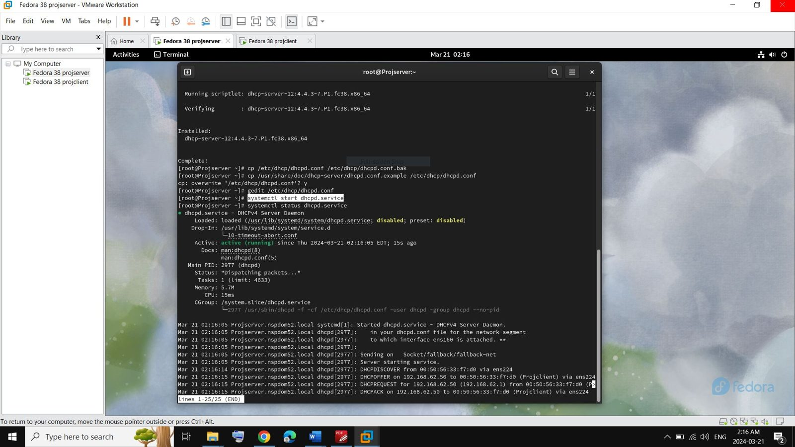
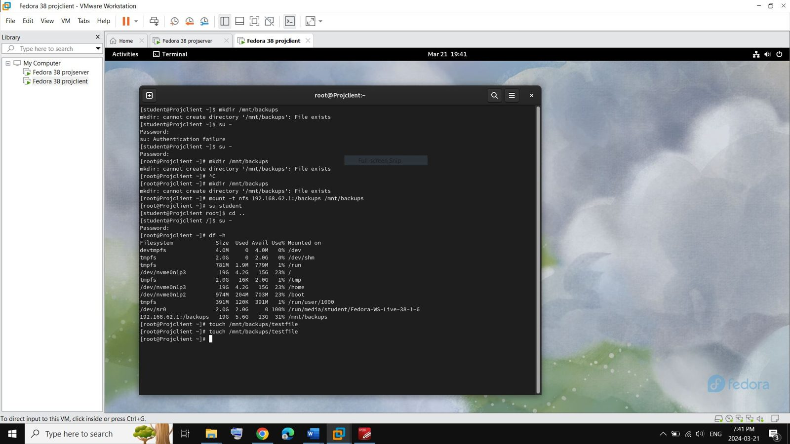
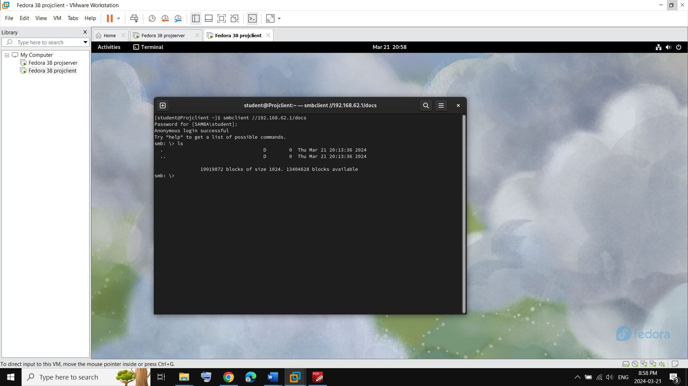
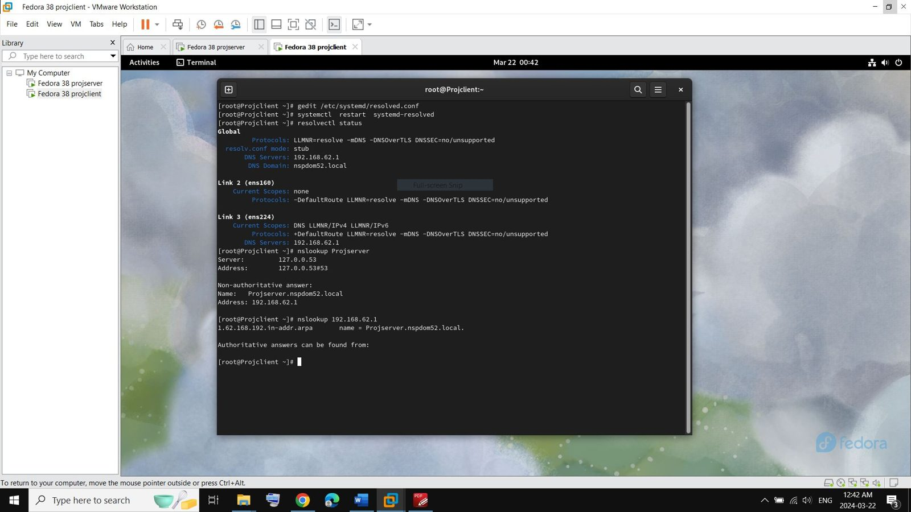
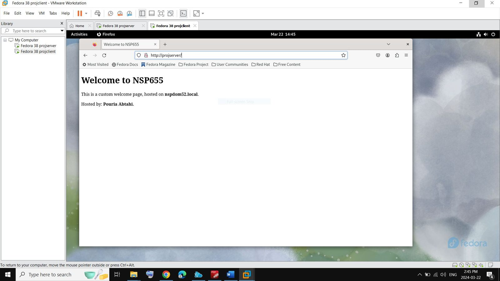
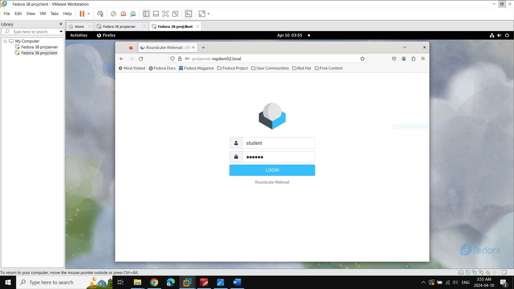

# Linux Network Services Lab (Fedora server and client)

A small office network built from scratch on two Fedora 38 virtual machines: one server that hands out addresses, resolves names, shares files, sends mail, hosts a website and a printer, and acts as the internet gateway; and one client that uses all of it.

Final project for **NSP655 Network Servers and Peripherals** at Seneca Polytechnic, Winter 2024. Individual project.

## The setup

```
           Internet
              |
        (NAT, ens160)
   +-----------------------+            host-only network 192.168.62.0/24
   |  Projserver           |  ens224    +-----------------------+
   |  Fedora 38            |------------|  Projclient           |
   |  192.168.62.1         |            |  Fedora 38            |
   |  DHCP DNS NFS Samba   |            |  DHCP address from    |
   |  Mail Web CUPS VNC    |            |  .50 to .100          |
   |  firewalld + NAT      |            +-----------------------+
   +-----------------------+
            domain: nspdom52.local
```

Both machines ran in VMware Workstation Pro 17.5. I built the server first, then cloned it for the client and gave the clone new MAC addresses so the two wouldn't collide on the network. VMware's own DHCP on the host-only network was turned off so the server's DHCP could take over.

## What I configured

| Service | What it does in this network | Config |
|---|---|---|
| **DHCP** (dhcpd) | Gives the client an address between .50 and .100 | [dhcpd.conf](configs/server/dhcpd.conf) |
| **DNS** (BIND) | Forward zone `nspdom52.local` and reverse zone, checked with `named-checkconf` and `named-checkzone` | [dns-notes.md](configs/server/dns-notes.md) |
| **NFS** | `/backups` shared read-write to the subnet | [exports](configs/server/exports) |
| **Samba** | `/docs` shared read-only to guests, mounted on the client at boot | [smb.conf share](configs/server/smb.conf-docs-share), [fstab](configs/client/fstab-entries) |
| **Mail** (Sendmail, Dovecot) | SMTP plus POP3S/IMAP, MX record in DNS, Evolution client accounts for two users | in the write-up below |
| **Web** (Apache) | A welcome page, then a virtual host for Roundcube webmail on a MariaDB database | [roundcube-vhost.conf](configs/server/roundcube-vhost.conf) |
| **Printing** (CUPS) | HP LaserJet shared to the network, with CUPS listening on the internal interface for remote admin | [cupsd.conf changes](configs/server/cupsd.conf-changes) |
| **Remote desktop** (TigerVNC) | VNC session reached through an SSH tunnel by a script | [auto_vnc_ssh.exp](scripts/auto_vnc_ssh.exp) |
| **Firewall and NAT** (firewalld) | Only the needed services allowed. The client reaches the internet through the server using masquerading and IP forwarding | [firewall-and-nat.sh](configs/server/firewall-and-nat.sh) |
| **Backups** | Weekly cron job that tars `/etc` onto the NFS share | [backup_etc.sh](scripts/backup_etc.sh) |

## Evidence

| | |
|---|---|
|  **DHCP:** server running, with the DISCOVER, OFFER, REQUEST, ACK exchange leasing 192.168.62.50 to the client |  **NFS:** client mounts `192.168.62.1:/backups` and writes a test file |
|  **Samba:** client connects to `//192.168.62.1/docs` |  **DNS:** forward and reverse lookups both resolve through the server |
|  **Apache:** the server's page, opened from the client |  **Roundcube:** webmail served from the server, opened on the client |

## Problems I ran into

- **Internet access for the client.** Getting the client online through the server took the most work. Masquerading alone wasn't enough. The internet-facing interface (ens160) had to be in the external zone, and IP forwarding had to be enabled in `sysctl.conf` before source NAT worked.
- **Samba worked from the command line but not from the file manager.** `smbclient` connected fine, but GNOME Files didn't. I rechecked directory permissions (`chmod -R 755 /docs`), the `smb` and `nmb` services, and the firewall rules until the share opened from the GUI. Then I made it mount at boot with `cifs-utils` and `/etc/fstab`, and rebooted to confirm.
- **Dovecot mail permissions.** Dovecot couldn't open the mail spools until each user's file in `/var/mail` was set to `0600`.
- **Roundcube** was an optional extra task. It needed the LAMP stack, a MariaDB database and user, the schema import, an Apache virtual host, a firewall rule for HTTP, and the web installer, before the IMAP and SMTP settings worked.

## What I'd do differently outside a lab

- **SELinux and the firewall.** The course setup had me disable SELinux and stop the firewall at the start so services could be brought up one at a time. On a real server I would keep SELinux enforcing and open each service's ports as I added it.
- **SSH keys.** The VNC tunnel script originally stored an SSH password, which is redacted in this repo. Key-based SSH login would remove the need for it.
- **Mail encryption.** SMTP on port 25 ran without encryption in this lab. POP3 was already on TLS (port 995).
- **CUPS access.** In the lab, the CUPS admin pages accepted connections from any address (`Allow all`). I would limit them to the admin subnet.

## Tools

Fedora 38 · VMware Workstation Pro · systemctl · dnf · firewalld · dhcpd · BIND · NFS · Samba / cifs-utils · Sendmail · Dovecot · Apache httpd · MariaDB · Roundcube · CUPS / HPLIP · TigerVNC · SSH · expect · cron
